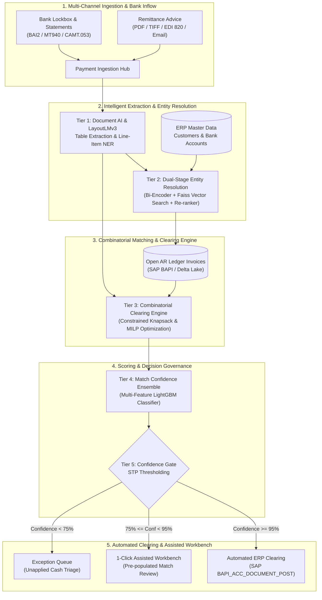

# Multi-Tiered Machine Learning & Combinatorial Optimization Architecture for Enterprise Cash Application in Order-to-Cash (O2C)

## Executive Summary & Context

**Cash Application** (the financial reconciliation process of matching incoming bank payments to outstanding Accounts Receivable invoices and clearing customer ledger accounts) represents one of the most operationally labor-intensive bottlenecks in enterprise **Order-to-Cash (O2C)**. 

While consumer payment matching is straightforward (1 payment of \$100 pays 1 bill of \$100), enterprise B2B payments exhibit massive combinatorial complexity:
- A single electronic funds transfer (ACH, Fedwire, SEPA, BACS) of \$642,810.25 often aggregates **50 to 200 distinct invoices** across multiple corporate subsidiaries.
- Payments frequently include deductions: prompt-pay cash discounts (e.g., 2% Net 10), debit/credit memos for returned or damaged merchandise, and freight charge short-payments.
- Remittance data arrives decoupled from the bank statement: messy email bodies, multi-page scanned PDF check stubs, or legacy EDI 820 messages with truncated invoice references.

A vanilla machine learning approach (e.g., a simple classifier or fuzzy string match) fails in production because it cannot handle multi-document layout extraction, entity resolution across master data hierarchies, or NP-hard combinatorial subset allocation. 

At Accenture, we architected an **enterprise multi-tiered pipeline** combining Document AI, semantic entity resolution, combinatorial knapsack optimization, and a calibrated confidence scoring gate to achieve **high-rate Straight-Through Processing (STP)** directly into SAP and Oracle ERPs.

---

## 1. End-to-End System Architecture

---

## 2. Multi-Tiered Component Deep-Dive

### 2.1 Tier 1: Document AI & Table Extraction Pipeline
- **Problem**: Remittance advice arrives via bank lockbox scans (skewed, handwritten notes, low-DPI TIFFs), email attachments, or EDI. Invoice numbers are often truncated (e.g., `INV-0094821` rendered as `94821` or misread by basic OCR as `INV-OO94821`).
- **Architecture**:
  - **Pre-processing**: OpenCV adaptive thresholding, deskewing, and morphological filtering.
  - **Layout & Token Extraction**: Fine-tuned **LayoutLMv3** combining 2D spatial bounding boxes, visual tokens, and text embeddings to classify document semantic tokens into:
    - `HEADER_PAYER_NAME`, `HEADER_PAYER_BANK`, `HEADER_CHECK_TOTAL`, `HEADER_REMIT_DATE`.
    - `LINE_INVOICE_NUMBER`, `LINE_GROSS_AMOUNT`, `LINE_DISCOUNT_AMOUNT`, `LINE_NET_AMOUNT`, `LINE_DEDUCTION_CODE`.
  - **Post-OCR Normalization**: Deterministic regex clean-up mapping common optical confusions (`O` $\leftrightarrow$ `0`, `I` $\leftrightarrow$ `1`, `S` $\leftrightarrow$ `5`) against customer invoice numbering templates.

### 2.2 Tier 2: Dual-Stage Customer Entity Resolution
- **Problem**: Payer names on bank wires rarely match ERP Customer Master records exactly (e.g., wire says *"JOHNSON CONTROLS DIV 8 UK"*, whereas SAP record is *"Johnson Controls International Plc #00049281"*).
- **Two-Stage Retrieval & Ranking**:
  1. **Stage A: Fast Vector Retrieval (Bi-Encoder)**:
     - Pre-trained Sentence-BERT fine-tuned on company legal names, DBA aliases, and addresses.
     - Vectors indexed in **Faiss (HNSW)**.
     - Queries against 500,000+ enterprise accounts in $< 4\text{ms}$, retrieving top-20 candidate customer IDs.
  2. **Stage B: High-Precision Cross-Encoder Re-ranker**:
     - Gradient boosted model evaluating:
       - Exact Bank Account / IBAN / Routing Number match (categorical weight: 0.98).
       - Tax Identification Number (EIN / VAT) match.
       - Syntactic string metrics: Jaro-Winkler, Levenshtein distance, token sort ratio.
       - Historical transactional graph: Has this bank account remitted for this SAP customer ID in the past 12 months?

### 2.3 Tier 3: Combinatorial Clearing Engine (Knapsack & MILP Optimization)
- **Problem**: In over 30% of wires, remittance advice is either absent or the remittance total does not cleanly sum to the check total due to unitemized deductions or cash discounts. Finding which subset of 500 open invoices matches a \$124,530.00 wire is an NP-hard problem.
- **Mathematical Formulation**:
  Let $N$ be the number of open invoices for the identified customer. For each invoice $j \in \{1, \dots, N\}$, let:
  - $A_j$ be the open invoice gross amount.
  - $D_j$ be the allowable prompt-pay cash discount.
  - $x_j \in \{0, 1\}$ be the binary decision variable (1 = invoice cleared, 0 = invoice unpaid).
  - $d_j \in \{0, 1\}$ be the discount indicator variable.
  - $P$ be the net payment amount deposited in the bank.
  - $\epsilon$ be the allowable rounding tolerance (typically $\le \$1.00$).

  We formulate the objective as a **Mixed-Integer Linear Program (MILP)**:
  $$\min_{\{x_j, d_j\}} \left| P - \sum_{j=1}^N \left( x_j A_j - d_j D_j \right) \right| + \lambda_1 \sum_{j=1}^N x_j \cdot \text{AgingPenalty}_j + \lambda_2 \sum_{j=1}^N (1 - d_j) \cdot \text{DiscountViolation}_j$$
  Subject to:
  $$d_j \le x_j \quad \forall j \in \{1, \dots, N\} \quad \text{(discount only taken if invoice selected)}$$
  $$d_j = 0 \quad \text{if } \text{PaymentDate} > \text{DiscountExpiryDate} + \text{GracePeriod}$$
  $$\left| P - \sum_{j=1}^N \left( x_j A_j - d_j D_j \right) \right| \le \text{MaxAllowableDelta}$$

- **Solver Implementation**: Solved using **Google OR-Tools / HiGHS** with branch-and-bound. Pruning heuristics constrain candidate invoices by matching PO numbers, FIFO aging buckets, and amount bounds, allowing the solver to converge in $< 250\text{ms}$ even on accounts with 2,000+ open line items.

### 2.4 Tier 4: Match Confidence Ensemble
Once candidate invoice allocations are generated, a calibrated **LightGBM ensemble** calculates a final probability score $C \in [0.0, 1.0]$ representing match certainty.
- **Features Ingested**:
  - Remittance line-item match percentage (exact vs fuzzy).
  - Residual balance delta ($|P - \sum \text{Matched}|$).
  - Cash discount validity (compliance with payment terms).
  - Temporal plausibility: Invoice date $\le$ Payment date $\le$ Current date.
  - Historical behavioral consistency: Probability that customer pays these specific SKUs or plants together.
- **Probability Calibration**: Calibrated using Platt Scaling to guarantee that matches with a score $\ge 0.95$ have an empirical error rate under $0.5\%$.

### 2.5 Tier 5: Straight-Through Processing (STP) Decision Gate
The calibrated score determines the operational path:
1. **Confidence $\ge 95\%$ (Straight-Through Processing - STP)**:
   - Direct execution via SAP BAPI (`BAPI_ACC_DOCUMENT_POST` / `BAPI_INCOMINGPAYMENT_CREATE`).
   - Clears open customer AR line items, posts discount deductions to General Ledger (GL) cash discount accounts, and reconciles the bank lockbox clearing account.
   - **Zero human touch**.
2. **$75\% \le \text{Confidence} < 95\%$ (Assisted 1-Click Workbench)**:
   - Displays the remittance PDF alongside pre-selected invoice candidates in the Cash Application UI.
   - Specialist reviews the match and approves with a single hotkey, reducing processing time from 12 minutes to 15 seconds.
3. **Confidence $< 75\%$ (Exception Handling)**:
   - Automated routing to dispute or cash specialist with flagged discrepancies (e.g., *"Unidentified customer credit memo of \$3,400"*, *"Post-discount payment received 45 days late"*).

---

## 3. Production Operational Metrics & Impact

- **Straight-Through Processing (STP) Rate**: Increased from **24% (legacy rules-based engine)** to **88.4%** across global shared service centers.
- **Unapplied Cash Reduction**: Reduced unapplied balance sheet cash by **72% within 90 days**.
- **Credit Limit Release Latency**: Slashed the lag between customer payment and credit line restoration from **36–48 hours to under 10 minutes**, eliminating blocked sales orders for active enterprise customers.
- **Deduction Recovery**: Automated identification of unauthorized late discounts recovered **\$4.8M annually** in recovered supplier margin.

---

## 4. Key Interview Talking Points

1. **Why is Cash Application not just a simple OCR or search problem?**
   > *"In enterprise B2B, payments are many-to-many: one check clears 80 invoices with partial deductions, unitemized discounts, and credit memos. OCR gets you the text, but you need combinatorial optimization (MILP knapsack solving) to reconcile the dollars, and a calibrated ML ensemble to guarantee 99.5%+ accuracy before writing financial postings directly into SAP."*

2. **How did you prevent the Knapsack problem from exploding computationally?**
   > *"With thousands of open invoices, pure subset-sum is NP-hard. We used candidate pruning heuristics: clustering open invoices by purchase order, applying hard bounding boxes on customer payment date windows, and pre-filtering by customer master entity resolution. This reduced candidate search spaces from $2^{2000}$ to under $2^{30}$, allowing Google OR-Tools to solve the MILP in under 300 milliseconds."*

3. **How did you ensure financial compliance and prevent incorrect ERP postings?**
   > *"No financial posting occurred without passing the STP Confidence Gate calibrated at 95% certainty with Platt scaling. Any score below 95% was surfaced to an assisted human-in-the-loop workbench with pre-populated line items. Furthermore, all postings were atomic: if the debit to bank clearing didn't exactly equal credits to AR plus allowable GL deductions, the transaction was rolled back."*
