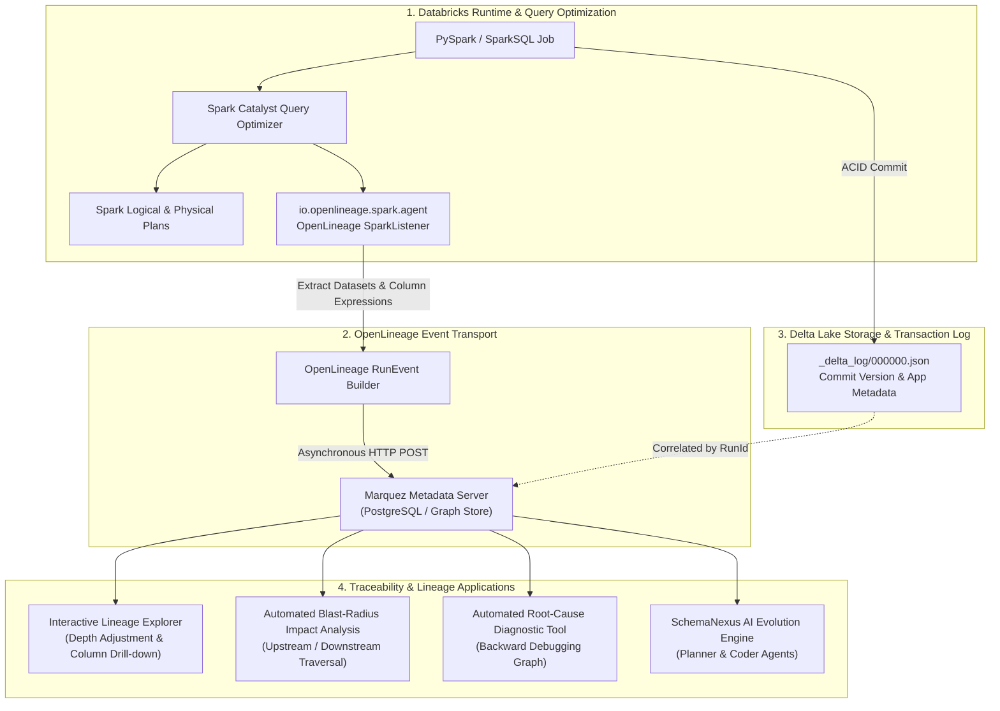

# Enterprise Data Traceability & Column-Level Lineage on Databricks Delta Lake with OpenLineage & Marquez

## Executive Summary & Context

In modern enterprise Lakehouse platforms—such as the large-scale Databricks Delta Lake implementations led by Kushal Sharma at Accenture (2023–2025)—data organizations manage petabyte-scale data flowing through **Medallion Architecture** layers:
$$\text{Raw / Operational Systems} \longrightarrow \textbf{Bronze} \text{ (Raw Append)} \longrightarrow \textbf{Silver} \text{ (Cleansed/Enriched)} \longrightarrow \textbf{Gold} \text{ (Business Aggregates / Data Marts)}$$

While traditional data platforms rely on static metadata catalogs or manual documentation, enterprise-scale platforms suffer from severe operational and regulatory blind spots:
1. **Regulatory & Audit Mandates (BCBS 239, GDPR, SOX, HIPAA)**: Financial and operational metrics published in executive dashboards must have auditable, mathematical proof of provenance showing the exact line of code, transform logic, and source transaction that produced them.
2. **Upstream Failure Blast-Radius Analysis**: When an upstream ingestion job stalls or corrupts at 02:00 AM, data engineering teams traditionally spend hours determining which downstream Gold marts, PowerBI dashboards, and ML feature tables are compromised.
3. **Column-Level Lineage Blindness**: Table-level lineage indicates only that Table A feeds Table B; it fails to explain *which specific input columns* compute a calculated metric (e.g., how `net_revenue` is derived through currency conversions and tax exclusions).

To solve this, we engineered an **automated, runtime-instrumented Data Traceability Framework** embedding **OpenLineage** into Databricks PySpark clusters and persisting complete execution graphs into a centralized **Marquez** metadata backend.

---

## 1. End-to-End System Architecture



---

## 2. Core Architectural Pillars

### 2.1 Runtime Instrumentation via OpenLineage Spark Agent
Static code parsing (e.g., analyzing SQL strings or Python ASTs) fails in enterprise PySpark because pipelines utilize dynamic SQL generation, temporary views, UDFs, and complex joins. 

We instrumented Databricks clusters at the bytecode level via the Spark execution listener:
```bash
# Databricks Cluster Spark Configuration
spark.driver.extraJavaOptions -javaagent:/databricks/jars/openlineage-spark-1.x.jar
spark.sql.queryExecutionListeners io.openlineage.spark.agent.OpenLineageSparkListener
spark.openlineage.transport.type http
spark.openlineage.transport.url https://marquez-service.internal.net:5000
spark.openlineage.namespace databricks-prod-lakehouse
spark.openlineage.facets.columnLineage.disabled false
spark.openlineage.facets.spark.logicalPlan.disabled false
```

- **Catalyst Hooking**: The OpenLineage listener hooks directly into the Spark Catalyst query planner after the logical analysis phase. It inspects the resolved logical plan (`LogicalPlan`), extracting the exact source tables, target tables, column projections, and filter conditions.
- **Zero Performance Overhead**: Event emission runs asynchronously on a decoupled worker thread pool, ensuring zero latency impact on Spark job execution time (<0.1% overhead).

### 2.2 Marquez Metadata Graph & Facet Structure
Marquez ingests OpenLineage `RunEvent` payloads, constructing a versioned, bitemporal Directed Acyclic Graph (DAG) of datasets, jobs, and runs.
- **Standard OpenLineage Facets Captured**:
  1. `nominalTime`: Scheduled pipeline execution window.
  2. `columnLineage`: Exact mapping of target columns to source attributes:
     ```json
     {
       "columnLineage": {
         "fields": {
           "effective_yield": {
             "inputFields": [
               { "namespace": "databricks-prod", "name": "silver.production_runs", "field": "gross_output" },
               { "namespace": "databricks-prod", "name": "silver.production_runs", "field": "scrap_count" }
             ],
             "transformationDescription": "gross_output - scrap_count",
             "transformationType": "DIRECT_ARITHMETIC"
           }
         }
       }
     }
     ```
  3. `schema`: Data types, nullable flags, descriptions.
  4. `dataSource`: Physical URI (`dbfs:/mnt/lake/gold/kpi_summary`).

### 2.3 Correlating OpenLineage with Delta Lake Transaction Logs
To achieve true auditability, metadata must be linked to physical storage commits:
- In Delta Lake, every table mutation produces an atomic JSON commit in `_delta_log/` (e.g., `000042.json`).
- We configured the PySpark pipelines to inject the OpenLineage `runId` directly into the Delta commit metadata:
  ```python
  spark.conf.set("spark.databricks.delta.commitInfo.userMetadata", f"openlineage_run_id={run_id}")
  ```
- **Bitemporal Time Travel Auditability**: If an auditor asks why a financial figure was reported on November 15, engineers can query Marquez to find the exact job run, extract the associated Delta commit version, and execute:
  ```sql
  SELECT * FROM gold.finance_report TIMESTAMP AS OF '2025-11-15 00:00:00'
  ```

---

## 3. High-Value Operational Capabilities

### 3.1 Automated Blast-Radius & Impact Analysis
When a data incident occurs (e.g., a critical upstream vendor feed arrives corrupted or an operational table schema evolves):
- Engineers or automated monitoring bots trigger a downstream traversal on the Marquez graph:
  $$\text{Impacted Set}(D) = \big\{ D_{\text{child}} \mid \exists \text{ path } D \rightsquigarrow D_{\text{child}} \text{ in Marquez DAG} \big\}$$
- SchemaNexus and PagerDuty immediately notify downstream consumers and temporarily quarantine dependent Gold tables before executives open corrupted reports.

### 3.2 Backward Root-Cause Triage
When an anomaly is flagged in a Gold BI metric:
- The system traverses the graph **upstream** from Gold $\rightarrow$ Silver $\rightarrow$ Bronze.
- By comparing the input/output row counts and data profiles captured in Marquez job run facets, the triage tool isolates the exact ETL step where row counts dropped or null values surged, reducing root-cause investigation time from **4 hours to 90 seconds**.

---

## 4. Key Interview Talking Points

1. **How does OpenLineage differ from traditional static metadata scrapers?**
   > *"Traditional tools parse SQL scripts stored in Git repositories. In real-world enterprise Databricks workloads, queries are generated dynamically at runtime, DataFrames are chained programmatically in PySpark, and temporary views are created on the fly. OpenLineage hooks directly into the Spark Catalyst query planner at runtime, capturing the exact physical plan and column transformations actually executed by the cluster."*

2. **How did you handle column-level lineage at petabyte scale?**
   > *"Column-level lineage extraction can produce massive metadata graphs. By leveraging Marquez's indexed bitemporal schema and configuring the OpenLineage Spark agent to emit dataset facets only upon successful job completion (and filtering out intermediate temporary shuffle DataFrames), we achieved microsecond query latency across tens of thousands of pipeline nodes."*

3. **What business ROI was delivered?**
   - **Regulatory Compliance**: Passed external banking and operational audits with zero findings, generating automated audit lineage reports in seconds.
   - **Incident Response (MTTR)**: Slashed incident triage time by **75%**, identifying upstream root causes within minutes.
   - **Schema Evolution Enabler**: Served as the foundational intelligence graph powering **SchemaNexus**, enabling autonomous impact analysis and schema change propagation.
